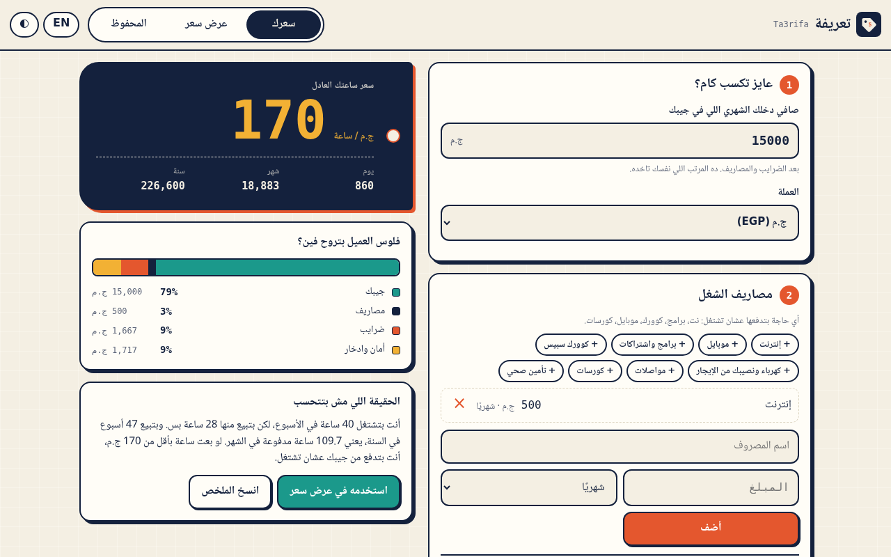
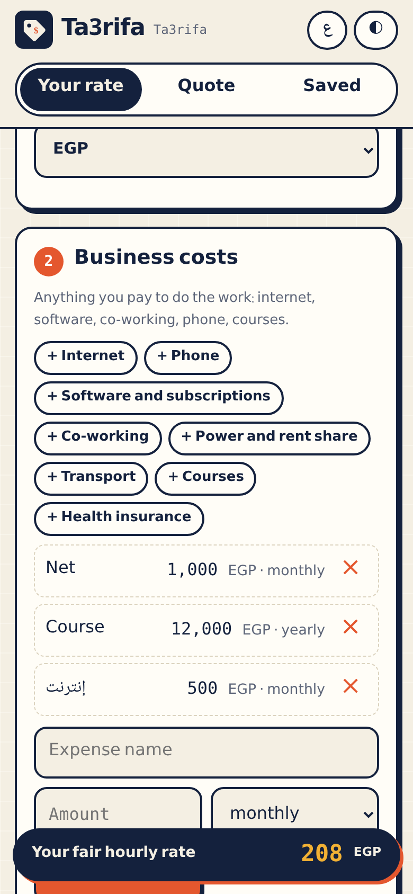
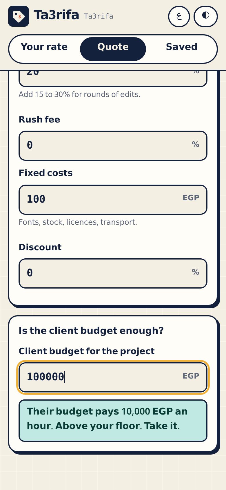
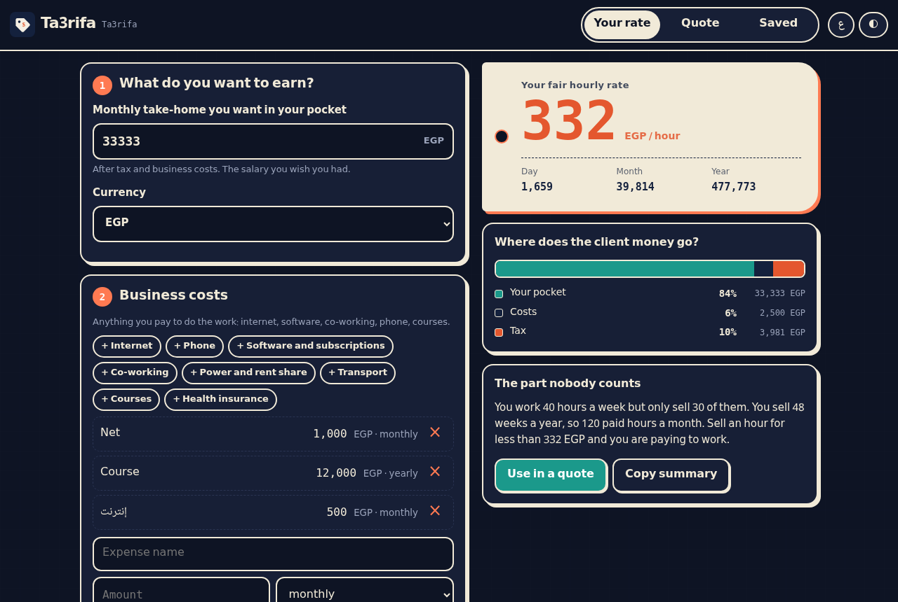

<p align="center"></p>
<h1 align="center">Ta3rifa · تعريفة</h1>
<p align="center"><b>Your costs + your taxes + your real hours = your fair price.</b><br>
حاسبة سعر الفريلانسر: مصاريفك + ضرايبك + ساعاتك = سعرك العادل.</p>
<p align="center"><a href="https://yousefkhames.github.io/ta3rifa/"><b>Live demo →</b></a></p>


## Screenshots

Captured from the live site (https://yousefkhames.github.io/ta3rifa/).

<p>
  
  
</p>

## The pitch

Most freelancers price by guessing, or by copying a competitor. Ta3rifa starts from the other end: how much you want in your pocket each month, what your work costs, how much tax and platform fee you pay, and how many hours you can really sell after holidays and unpaid admin. It gives you an hourly rate, a day rate and a monthly target. Then it turns that rate into a client quote and tells you if a client's budget is below your floor.

## Features

- **Rate calculator.** Take-home goal, itemised monthly and yearly costs, tax rate (with an option to deduct costs before tax), platform fee, safety margin, rounding.
- **Real hours.** Weeks off, unpaid time (emails, meetings, finding clients) and paid hours per day. You see how many hours you really sell each month.
- **Where the money goes.** A bar and legend splitting client money into your pocket, costs, tax, savings margin and platform fee.
- **Quote builder.** Hours, rate, revision buffer, rush fee, fixed costs and discount, with the effective hourly rate shown at the end.
- **Budget check.** Enter the client's budget and get ok, close or below-floor, plus the gap.
- **Saved quotes.** Save, reopen and delete quotes. Copy as text, print or save as PDF from the browser, export and import a JSON backup.
- **Arabic and English.** Full RTL and LTR switch, light and dark theme, mobile first.
- **Five currencies as labels:** EGP, USD, SAR, AED, EUR.
- Installable as a home-screen app and opens offline after the first visit.

## Screenshots

| English | Quote | Dark desktop |
|---|---|---|
|  |  |  |

## The math

```
revenue  = takeHome / (1 - tax) + costs          (costs deducted before tax)
revenue  = (takeHome + costs) / (1 - tax)        (costs not deducted)
target   = revenue * (1 + margin)
clientPays = target / (1 - platformFee)
paidHours/month = hoursPerWeek * (1 - unpaid%) * (52 - weeksOff) / 12
hourly   = clientPays / paidHours/month
```

## Tech

Plain HTML, CSS and JavaScript. No framework, no build step, no server, no tracking. State lives in `localStorage`. The calculation core is `calc.js`, a small UMD module used by both the page and the tests.

## Tests

```
npm test            # 15 unit tests for the calculation core (node:test)
npm i && npm run e2e   # real Chrome click-through with puppeteer-core
```

The end-to-end script runs against a local server by default, or against any URL: `node tests/e2e.js https://yousefkhames.github.io/ta3rifa/`. It checks the rate formula against the UI, expenses, persistence across reload, language and direction switch, quote totals, budget verdicts, saving, import and export, dark theme, a zero-hours edge case and console errors.

## Honest limits

- Your data stays in this browser only. Clearing site data erases it. Export a backup.
- No currency conversion. The currency is a label, and you type amounts in it.
- Tax is one flat percentage you choose. It does not know any country's brackets. Ask an accountant.
- GitHub Pages is a demo host, not production hosting.
- It is a pricing aid, not financial advice.

## License

MIT


## Demo / portfolio project

Static GitHub Pages site. Data stays in your browser. Sample data is fictional and results are not professional, legal, medical or financial advice.

By Yousef Khames · من تطوير يوسف خميس
